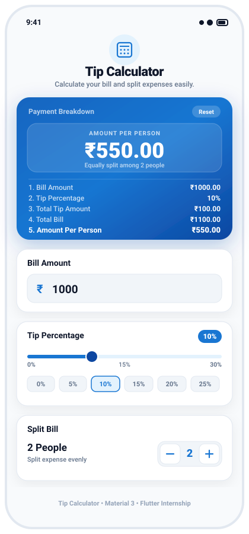

# 💰 Tip Calculator App

A modern, polished, and responsive single-screen **Tip Calculator** application built with **Flutter** and **Material 3**. Designed and engineered to provide seamless bill calculation, tip adjustment, and split-expense management for official internship submission.

---

## 🎯 Internship Project Objective

The primary objective of this project is to develop an internship-submission-ready, single-screen Flutter application that allows users to easily calculate total bills, custom tip amounts, and individual payments split among multiple diners or companions.

The application strictly adheres to the following criteria:
- **Material 3 Design System**: Professional blue and white aesthetic with gentle elevation, rounded cards, and responsive typography.
- **State Management**: Reactive state handling using `StatefulWidget` and `setState()` for instantaneous live updates.
- **Core Widgets Implementation**: Effective utilization of `TextField`, `Slider`, `Row`, `Column`, `Container`, `Text`, `IconButton`, `InkWell`, `SafeArea`, and `SingleChildScrollView`.
- **Pure & Lightweight Architecture**: Zero external or unnecessary third-party package dependencies, ensuring optimal performance, instant startup, and cross-platform compatibility.
- **Input Validation & Safety**: Gracefully handles empty, zero, and invalid inputs without runtime exceptions.
- **Pixel-Perfect Responsiveness**: Prevents overflow across various mobile screen widths, tablet viewports, and orientation changes.

---

## ✨ Features

- **🎨 Modern Blue & White Palette**:
  - Primary Royal Blue (`#1976D2`) & Deep Navy (`#0D47A1`).
  - Subtle borders (`#E2E8F0`), soft drop shadows, and clean slate background (`#F8FAFC`).
- **📱 App Header**:
  - Title: **Tip Calculator**.
  - Subtitle: *"Calculate your bill and split expenses easily."*
  - Branded circular calculator badge.
- **💵 Bill Amount Input**:
  - Dedicated numeric `TextField` supporting decimal currency entry.
  - Formatted currency prefix with Indian Rupee symbol (`₹`).
  - Real-time calculation triggers on every keystroke.
  - Interactive clear button (`cancel_rounded`) to reset bill text.
  - Safe parsing guarding against negative numbers, empty strings, and non-numeric characters.
- **📊 Tip Percentage Slider**:
  - Material 3 `Slider` with a range from **0% to 30%** (default: **10%**).
  - Clear real-time percentage badge.
  - Quick-select preset chips (`0%`, `5%`, `10%`, `15%`, `20%`, `25%`) for fast selection.
  - Live calculation synchronization upon sliding.
- **👥 Split Bill Between People**:
  - "Split Bill" control panel.
  - Live count indicator with dynamic text (*"1 Person"* vs *"X People"*).
  - Tactile decrement (`-`) and increment (`+`) control buttons.
  - Minimum restriction enforced at 1 person (prevents division by zero or negative count).
  - Visual disabled state styling on the decrement button when count is 1.
- **🏆 Live Calculation Results Card (Hero Component)**:
  - High-contrast gradient card (`#1565C0` ➔ `#0D47A1`).
  - **Amount Per Person** prominently highlighted as the primary figure with large bold typography.
  - Complete, structured breakdown:
    1. **Bill Amount** (e.g., `₹1000.00`)
    2. **Tip Percentage** (e.g., `10%`)
    3. **Total Tip Amount** (e.g., `₹100.00`)
    4. **Total Bill** (Bill + Tip, e.g., `₹1100.00`)
    5. **Amount Per Person** (e.g., `₹550.00`)
  - Two decimal places currency formatting across all financial metrics.
  - Integrated **Reset** action button to restore defaults in one click.

---

## 📐 Calculation Formulas

All financial calculations are computed dynamically and encapsulated in an immutable model:

$$\text{Tip Amount} = \text{Bill Amount} \times \left(\frac{\text{Tip Percentage}}{100}\right)$$

$$\text{Total Bill} = \text{Bill Amount} + \text{Tip Amount}$$

$$\text{Amount Per Person} = \frac{\text{Total Bill}}{\text{Number of People}} = \frac{\text{Bill Amount} + \text{Tip Amount}}{\text{Number of People}}$$

### Sample Verification Scenario
| Parameter | Value |
| :--- | :--- |
| **Bill Amount** | ₹1,000.00 |
| **Tip Percentage** | 10% |
| **Number of People** | 2 |
| **Calculated Tip Amount** | **₹100.00** |
| **Calculated Total Bill** | **₹1,100.00** |
| **Calculated Amount Per Person** | **₹550.00** |

---

## 🖼️ UI Design & Screenshots

### Visual Application Layout

```text
+-------------------------------------------------------------+
|  [ 9:41 ]                                      [ 📶 🔋 100%]|
+-------------------------------------------------------------+
|                                                             |
|                          ( 🧮 )                             |
|                      Tip Calculator                         |
|         Calculate your bill and split expenses easily.      |
|                                                             |
|   +-----------------------------------------------------+   |
|   |  Payment Breakdown                         [ Reset ]|   |
|   |  +-----------------------------------------------+  |   |
|   |  |              AMOUNT PER PERSON                |  |   |
|   |  |                   ₹550.00                     |  |   |
|   |  |          Equally split among 2 people         |  |   |
|   |  +-----------------------------------------------+  |   |
|   |  -------------------------------------------------  |   |
|   |  1. Bill Amount                            ₹1000.00 |   |
|   |  2. Tip Percentage                              10% |   |
|   |  3. Total Tip Amount                        ₹100.00 |   |
|   |  4. Total Bill                             ₹1100.00 |   |
|   |  5. Amount Per Person                       ₹550.00 |   |
|   +-----------------------------------------------------+   |
|                                                             |
|   +-----------------------------------------------------+   |
|   |  [🧾] Bill Amount                                   |   |
|   |  [ ₹ | 1000                                     (x) ]|  |
|   +-----------------------------------------------------+   |
|                                                             |
|   +-----------------------------------------------------+   |
|   |  [%] Tip Percentage                          [ 10% ]|   |
|   |  [----o--------------------------------------------]|   |
|   |   0%                      15%                   30% |   |
|   |  [ 0% ] [ 5% ] [ 10%* ] [ 15% ] [ 20% ] [ 25% ]     |   |
|   +-----------------------------------------------------+   |
|                                                             |
|   +-----------------------------------------------------+   |
|   |  [👥] Split Bill                                    |   |
|   |  2 People                                           |   |
|   |  Split expense evenly          [ - ]  [ 2 ]  [ + ]  |   |
|   +-----------------------------------------------------+   |
|                                                             |
|          ⭐ Tip Calculator • Material 3 • Flutter           |
+-------------------------------------------------------------+
```

### UI Preview Vector
Vector preview mockup available at [`screenshots/preview.svg`](screenshots/preview.svg).

```markdown
<!-- Screenshot Placeholder -->

```

---

## 📁 Project Structure

The project follows a clean, modular architecture separating models, themes, reusable widgets, and screens:

```text
internship-calculator/
├── .idea/                             # IntelliJ project configuration & run configurations
│   ├── modules.xml
│   └── runConfigurations/
│       └── main_dart.xml
├── android/                           # Android native configuration
│   ├── app/
│   │   ├── build.gradle
│   │   └── src/main/AndroidManifest.xml
│   ├── build.gradle
│   └── settings.gradle
├── web/                               # Web runner configuration
│   ├── index.html
│   └── manifest.json
├── lib/
│   ├── main.dart                      # Application entry point & theme initialization
│   ├── models/
│   │   └── calculation_result.dart    # Pure business logic & calculation model
│   ├── theme/
│   │   └── app_theme.dart             # Material 3 colors, gradients, shadows & theme data
│   ├── widgets/
│   │   ├── app_header.dart            # Branded header title & subtitle widget
│   │   ├── bill_input_card.dart       # Numeric TextField with ₹ currency prefix
│   │   ├── tip_slider_card.dart       # 0%-30% Slider & quick-select preset chips
│   │   ├── split_bill_card.dart       # People counter with plus/minus buttons
│   │   └── result_card.dart           # Hero gradient card highlighting Per-Person amount
│   └── screens/
│       └── tip_calculator_screen.dart # Main StatefulWidget managing reactive UI state
├── test/
│   ├── calculation_test.dart          # Comprehensive unit test suite for calculation logic
│   └── widget_test.dart               # Automated widget test suite for UI interactions
├── screenshots/
│   └── preview.svg                    # Scalable vector graphic preview of the application
├── .gitignore                         # Standard git ignore rules
├── .metadata                          # Flutter tool metadata
├── analysis_options.yaml              # Strict Flutter lint rules
├── internship-calculator.iml          # IntelliJ module file
├── pubspec.yaml                       # Flutter project manifest & dependencies
└── README.md                          # Comprehensive project documentation
```

---

## 🛠️ Technologies Used

- **Framework**: Flutter (Material 3 enabled)
- **Language**: Dart 3
- **State Management**: `StatefulWidget` & `setState()`
- **Architecture**: Modular Component-Driven Architecture
- **IDE Support**: IntelliJ IDEA / Android Studio / VS Code

---

## 🚀 Installation & Running

### Prerequisites
1. Install [Flutter SDK](https://flutter.dev/docs/get-started/install) (version 3.0.0 or higher).
2. Ensure Android Studio, IntelliJ IDEA, or VS Code is installed with Flutter and Dart plugins.
3. Connect a physical device or launch an Android / iOS emulator / Chrome browser.

### Clone the Repository
```bash
git clone https://github.com/aditi03092004/internship-calculator.git
cd internship-calculator
```

### Install Dependencies
```bash
flutter pub get
```

### Run Code Analysis
```bash
flutter analyze
```

### Run Tests
Execute the automated test suite:
```bash
# Run standalone calculation unit tests
dart test/calculation_test.dart

# Run Flutter widget test suite
flutter test
```

### Launch the Application
```bash
# Run on connected device / emulator
flutter run

# Run on Chrome
flutter run -d chrome
```

---

## 🧪 Automated Testing Verification

The project includes unit and widget tests covering:
- **Calculation Accuracy**: Validates sample inputs (₹1000 bill, 10% tip, 2 people = ₹100 tip, ₹1100 total, ₹550 per person).
- **Edge Cases**: Zero bill amount, 0% tip, maximum 30% tip, high split counts.
- **Boundary Controls**: Prevents number of people from decrementing below 1.
- **State Synchronization**: Immediate updates across all fields when text or slider values change.
- **Reset Behavior**: Restores initial defaults cleanly.

---

## 👩‍💻 Author & Internship Information

- **Developer**: Aditi Anand Hundre
- **GitHub**: [@aditi03092004](https://github.com/aditi03092004)
- **Repository**: [internship-calculator](https://github.com/aditi03092004/internship-calculator)
- **Project**: Tip Calculator (Flutter Mobile Application)
- **Submission Type**: Official Internship Project Submission
